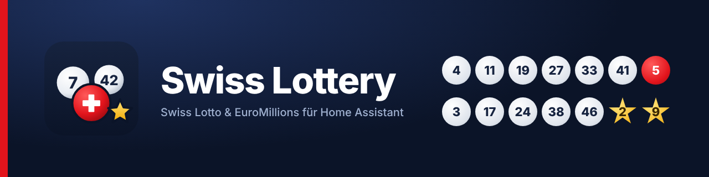

# Swiss Lottery (Swisslos)

[](https://hacs.xyz/docs/marketplace/)
[](LICENSE)
<a href="https://www.buymeacoffee.com/prusuino"></a>

A Home Assistant custom integration for the Swiss lottery games run by **Swisslos**: the winning numbers of the latest **Swiss Lotto**, **EuroMillions** and **EuroDreams** draw, the extra games (Joker, Super-Star, 2nd Chance, Replay), the jackpot and the next draw – and a check of **your own tickets** against every draw, with a bundled dashboard card that shows the drawn balls and highlights your hits.

Did my numbers come up on Wednesday? How big is Saturday's jackpot? Did ticket 2 win anything? That's what this integration answers, right on your dashboard – and a binary sensor that switches on when a ticket wins lets an automation tell you.

## Background

Swisslos publishes the result of every draw on [swisslos.ch](https://www.swisslos.ch). There is no feed or API, so the integration reads the published results page once an hour – a single request covers all three games – and turns them into entities. The page is parsed with the standard library; should Swisslos change its page layout, the entities become unavailable rather than showing something wrong, and the integration gets an update.

Your tickets never leave your instance: they are stored with the config entry and compared with the published numbers locally.

## What it provides

Add the integration once per game. Each game becomes a device with these entities (`<game>` is `swisslotto`, `euromillions` or `eurodreams`):

| Entity | Description |
|---|---|
| `sensor.swiss_lottery_<game>_numbers` | The drawn main numbers, e.g. `12, 26, 29, 30, 39, 42`. Its attributes carry the whole draw – date, bonus numbers, Replay / Joker / Super-Star / 2nd Chance, jackpot, next draw, the prize ranks and the result of every ticket – which is what the bundled card reads. |
| `sensor.swiss_lottery_<game>_bonus` | Lucky number (Swiss Lotto), the two stars (EuroMillions) or the dream number (EuroDreams). |
| `sensor.swiss_lottery_<game>_draw_date` | Date of the draw the numbers belong to. |
| `sensor.swiss_lottery_<game>_next_draw` | Closing time of the next draw (timestamp): tickets must be in before it. |
| `sensor.swiss_lottery_<game>_jackpot` | Jackpot of the next draw in CHF, as published (Swiss Lotto, EuroMillions). The Joker / Super-Star jackpot is an attribute. |
| `sensor.swiss_lottery_<game>_extra_game` | The drawn Joker number (Swiss Lotto) or Super-Star code (EuroMillions), with that game's prize ranks as attributes. |
| `sensor.swiss_lottery_swisslotto_replay` | The Replay number of the Swiss Lotto draw. |
| `sensor.swiss_lottery_euromillions_second_chance` | The five 2nd Chance numbers of the EuroMillions draw. |
| `sensor.swiss_lottery_<game>_ticket_<n>` | One per configured ticket: the number of main numbers matched in the latest draw. Attributes: the matched numbers, matched bonus numbers, the prize rank (e.g. `5+1`), the prize and whether the ticket won. |
| `binary_sensor.swiss_lottery_<game>_win` | On when at least one of your tickets won in the latest draw; the winning tickets with rank and prize are attributes. Trigger a notification on it. |

These are the ids suggested when the entities are first created; rename them in the entity settings if you like. Entity names follow your Home Assistant language (German, English, French, Italian).

The results are refreshed once an hour. Draws take place in the evening – Swiss Lotto on Wednesday and Saturday, EuroMillions on Tuesday and Friday, EuroDreams on Monday and Thursday – and Swisslos publishes them within the hour, so a ticket is checked at the latest about two hours after the draw.

## Installation

### Home Assistant Marketplace (custom repository)

1. Open **Settings → Marketplace → ⋮ → Custom repositories** (Home Assistant 2026.11 or newer; on older versions **HACS → ⋮ → Custom repositories**), add `https://github.com/prusuino/ha_swiss_lottery` with the category *Integration*, then download **Swiss Lottery** – or use the button:

   [](https://my.home-assistant.io/redirect/hacs_repository/?owner=prusuino&repository=ha_swiss_lottery&category=integration)

2. Restart Home Assistant.

### Manual

1. Copy the `custom_components/swiss_lottery` folder into your Home Assistant `config/custom_components/` directory.
2. Restart Home Assistant.

## Setup

1. Go to **Settings → Devices & Services → Add Integration** and search for **"Swiss Lottery"**.
2. Pick the game and, if you like, enter your tickets – one per line, the main numbers followed by `+` and the bonus number(s):

   | Game | Ticket format | Example |
   |---|---|---|
   | Swiss Lotto | 6 numbers (1–42) + lucky number (1–6) | `4 11 19 27 33 41 + 5` |
   | EuroMillions | 5 numbers (1–50) + 2 stars (1–12) | `3 17 24 38 46 + 2 9` |
   | EuroDreams | 6 numbers (1–40) + dream number (1–5) | `4 8 15 16 23 38 + 1` |

   Commas or dashes work as well, and without a `+` the last number(s) count as the bonus – `4,11,19,27,33,41,5` is the same Swiss Lotto ticket. Up to ten tickets per game.
3. Add the integration again for the other games. Tickets can be changed at any time under **Configure** on the integration's entry.

Replay, Joker and Super-Star are not checked automatically – their numbers are shown, and whether your Joker matches is a glance at the Joker sensor.

## Dashboard card

The integration ships a Lovelace card, **Swiss Lottery** (`custom:swiss-lottery-card`), with a visual editor: the drawn balls (bonus numbers in colour), the extra games, the jackpot and the next draw, and your tickets with the matched numbers highlighted and the prize rank next to a winning ticket. Optionally the full prize table of the draw.


The card file is served by the integration, but registering it as a Lovelace resource is left to you – the resource list is part of your dashboard configuration. It is a one-time step:

**Settings → Dashboards → ⋮ (top right) → Resources → + Add resource**

| Field | Value |
|---|---|
| URL | `/swiss_lottery_files/swiss-lottery-card.js` |
| Resource type | JavaScript module |

Then reload the page (Ctrl/Cmd+Shift+R). The *Resources* entry is only shown when **Advanced mode** is enabled in your user profile. Afterwards the card appears in the card picker as **Swiss Lottery**:

```yaml
type: custom:swiss-lottery-card
entity: sensor.swiss_lottery_swisslotto_numbers
title: Swiss Lotto      # optional
show_tickets: true      # your tickets with hits highlighted (default true)
show_jackpot: true      # jackpot and next draw (default true)
show_extra: true        # Replay / Joker / Super-Star / 2nd Chance (default true)
show_ranks: false       # the prize table of the draw (default false)
```

## Dashboard strategy

The integration ships a **dashboard strategy**: a recipe Home Assistant renders in the browser, rather than a dashboard written into your configuration. Nothing is stored, nothing is overwritten, and the result follows your setup — add a game and its section appears on the next page load; remove one and it is gone.

The integration deliberately does not create or modify any dashboard on your behalf — your dashboards stay entirely under your own control.

The strategy comes with the card: the resource registered [above](#dashboard-card) is all it needs, there is no second file.

### Using the strategy

1. **Settings → Dashboards → + Add dashboard → New dashboard from scratch**, give it a name.
2. Open it, then **✏️ (edit) → ⋮ → Raw configuration editor**.
3. Replace the entire content with:

```yaml
strategy:
  type: custom:swiss-lottery
views: []
```

4. Save.

You get:

- a **Draws** view — one section per game, in the order Swiss Lotto, EuroMillions, EuroDreams: the Swiss Lottery card with the drawn balls, the extra games, the jackpot, the next draw and your tickets, plus the win sensor and the closing time of the next draw as tiles. The prize table is left out; add the card yourself with `show_ranks: true` if you want it.

The strategy also appears under **+ Add dashboard** as *Swiss Lottery*, which does the same thing without the raw editor.

Everything the strategy produces is a normal Home Assistant dashboard built from standard cards. If you would rather arrange things yourself, the entities above are all you need — the strategy is an offer, not a requirement.

### Adjusting the strategy

A strategy dashboard has no card editor — the layout is generated fresh on every load. You still have two ways to shape it without giving that up:

**Options.** Anything you add under `strategy:` is passed to the recipe:

```yaml
strategy:
  type: custom:swiss-lottery
  title: My title
  max_columns: 3
views: []
```

| Option | Effect |
|---|---|
| `title` | dashboard title |
| `max_columns` | column count of the generated section views |

**One view inside your own dashboard.** Instead of a separate dashboard, let the strategy fill a single view of one you already have. Open your dashboard's raw configuration editor and add a view:

```yaml
views:
  - title: Home
    # ... your own cards ...
  - title: Swiss Lottery
    strategy:
      type: custom:swiss-lottery
```

That view is regenerated like the full dashboard is, so new config entries still appear by themselves, while every other view stays yours to edit. The same options work here too.

> **Take control** (⋮ menu) turns a strategy dashboard into a static one you can edit card by card — but it is one-way: the dashboard stops following your config entries from then on. Prefer the two approaches above.

## Automations

### Blueprint: notify on a winning ticket

The repository ships a blueprint that sends a notification to your phone when one of your tickets wins: the game, the draw date and, for every winning ticket, its number, prize rank and prize. Import it once, then create an automation from it and pick the win sensors of your games and your phone:

[](https://my.home-assistant.io/redirect/blueprint_import/?blueprint_url=https%3A%2F%2Fgithub.com%2Fprusuino%2Fha_swiss_lottery%2Fblob%2Fmain%2Fblueprints%2Fautomation%2Flottery_win_notification.yaml)

An action field takes your own steps, a text-to-speech announcement for instance; the notification text is available there as `{{ message }}`.

### Triggers and conditions in the automation editor

On Home Assistant 2026.10 or newer the integration adds its own entries to the automation editor:

| Trigger | Fires when |
|---|---|
| **A ticket has won** | the win sensor of a game switches on – the latest draw pays out on at least one of your tickets |
| **A draw was published** | the draw date of a game changes – Swisslos has published a new draw |
| **Jackpot crossed a threshold** | the jackpot of the next draw crosses an amount you set in CHF (or the value of a CHF entity) |

On 2026.11 or newer there are also two conditions, **A ticket has won** and **No ticket has won**. Each entry targets the integration's own entities (pick an entity, the game's device or an area); the usual *for* duration and behaviour options apply.

```yaml
triggers:
  - trigger: swiss_lottery.jackpot_crossed_threshold
    target:
      entity_id: sensor.swiss_lottery_swisslotto_jackpot
    options:
      threshold:
        type: above
        value: 20000000
```

### Building it yourself

```yaml
automation:
  - alias: Lottery win
    triggers:
      - trigger: state
        entity_id: binary_sensor.swiss_lottery_swisslotto_win
        to: "on"
    actions:
      - action: notify.mobile_app_phone
        data:
          title: Swiss Lotto
          message: >-
            
            Ticket {{ w[0].ticket }} won: rank {{ w[0].rank }}, CHF {{ w[0].prize }}
```

## Notes

- The jackpot shown is the amount Swisslos publishes for the next draw. EuroDreams has no jackpot (its top prize is an annuity, shown as published text).
- A ticket's prize is the published quota of its rank for that draw. Swisslos may correct quotas after publication; the official result is the one Swisslos publishes.
- If swisslos.ch is unreachable or changes its page layout, the entities become `unavailable` rather than showing stale numbers, and recover with the next successful refresh.
- This integration is unofficial and not affiliated with, endorsed by, or supported by Swisslos. It only reads the results Swisslos publishes on its website.

## Data source & license

Winning numbers, quotas, jackpots and draw dates are read from the published results pages of Swisslos (`https://www.swisslos.ch`) over HTTPS, once per hour with a single request that carries nothing about you – no account, no cookies, no ticket data. Every entity sets Home Assistant's `attribution` attribute accordingly (*Source: Swisslos*). The names Swiss Lotto, EuroMillions, EuroDreams, Joker and Super-Star are trademarks of their respective owners and are used only to describe the games.

## Disclaimer

This integration is provided **as-is, without any warranty**. The numbers and quotas are read from a third-party website and may be delayed, incomplete or incorrect, and the integration may stop working if that website changes. **It is not a substitute for checking your ticket with Swisslos**: the binding result of any draw is the one Swisslos publishes and verifies, and only Swisslos decides whether a ticket wins. The author(s) accept **no responsibility or liability** for any loss, missed prize, incorrect reading or other issue arising from using this integration, whether it stops working, behaves unexpectedly, or never worked correctly for your setup in the first place.

## License

Source code: MIT – see [LICENSE](LICENSE).

## Related integrations

More Home Assistant integrations from the same author:

- [Swiss Hail Protection](https://github.com/prusuino/ha_swiss_hail_protection) — Swiss hail warnings for your blinds: the official VKF hail-protection signal or the MeteoSwiss hail radar around your location
- [Swiss Waters](https://github.com/prusuino/ha_swiss_waters) — live water temperature, water level, discharge and flood danger levels of Swiss rivers and lakes
- [Swiss Public Alerts](https://github.com/prusuino/ha_swiss_public_alerts) — official Alertswiss warnings for your location
- [Swiss Earthquakes](https://github.com/prusuino/ha_swiss_earthquakes) — recent earthquakes from the Swiss Seismological Service on a map
- [Swiss Avalanche Bulletin](https://github.com/prusuino/ha_swiss_avalanche_bulletin) — SLF avalanche danger for your region
- [Swiss Electricity Price](https://github.com/prusuino/ha_swiss_electricity_price) — official ElCom electricity tariffs for your municipality
- [Swiss Solar Reference Price](https://github.com/prusuino/ha_swiss_solar_reference_price) — Swiss solar feed-in reference market price
- [Swiss Charging Stations](https://github.com/prusuino/ha_swiss_charging_stations) — real-time availability and prices of public EV charging stations in Switzerland
- [Swiss Public Transport](https://github.com/prusuino/ha_swiss_transport) — departure boards and connections for Swiss public transport
- [Swiss Parking](https://github.com/prusuino/ha_swiss_parking) — real-time parking availability in Swiss cities
- [Austrian Charging Stations](https://github.com/prusuino/ha_austrian_charging_stations) — real-time availability of public EV charging stations in Austria
- [Innoxel Master 3](https://github.com/prusuino/ha_innoxel_master3) — local control for INNOXEL building automation

## Support

If you find this integration useful, you can support its development:

<a href="https://www.buymeacoffee.com/prusuino"></a>
